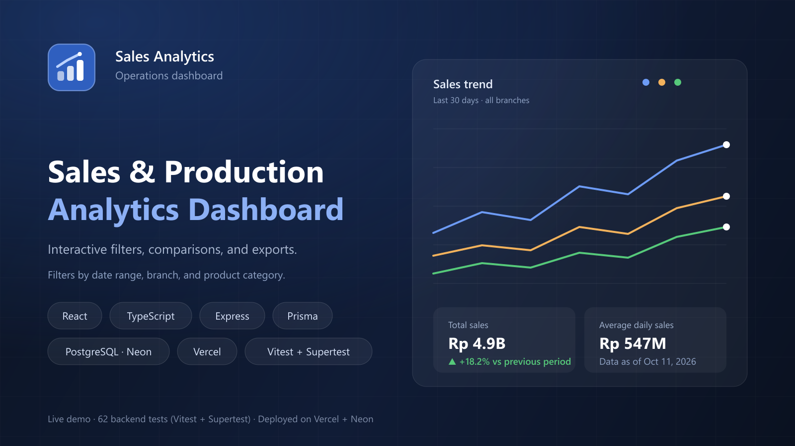

# Sales / Production Analytics Dashboard



**Live demo:** https://sales-production-analytics-dashboard-hikmaldevs-projects.vercel.app
(demo logins: `admin@example.com` / `admin12345` · `viewer@example.com` / `viewer12345`)

A full-stack analytics dashboard that turns raw sales/production tables into
charts a manager can read in seconds: filter by date range, branch, and
category, compare branches and categories, and export the current view to PDF
or Excel.

Built end-to-end from a PRD and design system (both in this repo): PostgreSQL
aggregation, a typed REST API, and a React dashboard with authenticated
viewer/admin roles.

## Features

- **Authentication** — email/password login with JWT sessions, viewer/admin
  roles enforced on the backend for every endpoint.
- **Dashboard** — sticky filters (date presets, branch, category) shared by
  every chart and summary card; KPI cards with period-over-period change.
- **Charts** — per-branch sales trend (day/week/month granularity, zero-filled
  buckets so lines stay continuous) and branch/category comparison charts with
  fixed series colours.
- **Exports** — server-generated PDF and Excel from the *same filters on
  screen*, recorded in `export_logs` with the exact filter snapshot.
- **Data import pipeline** — upload CSV or XLSX in Admin → Data sources:
  per-row validation, idempotent rows via `external_ref`, optional creation of
  missing master data, batch inserts, and a sync-run history that feeds the
  "Data as of" freshness label.
- **Administration** — users, branches & categories (deactivate instead of
  delete so historical reporting stays intact), data sources & sync history.
- **Correct by construction** — all totals/grouping happen in PostgreSQL
  queries, never by summing rows in the browser.

## Tech stack

| Layer | Choice |
|---|---|
| Frontend | React 19, TypeScript, Vite, TanStack Query, Recharts |
| Backend | Node.js, Express 5, TypeScript, Zod |
| Database | PostgreSQL (Neon) via Prisma 7 with driver adapters |
| Exports | PDFKit (PDF), ExcelJS (XLSX) |
| Tests | Vitest + Supertest (dedicated test database) |
| Deploy | Vercel (SPA + Express as a Vercel Function), Neon |

## Getting started

```bash
npm install
cp .env.example .env    # DATABASE_URL (pooled), DIRECT_URL, JWT_SECRET
npx prisma migrate deploy
npm run db:seed         # demo data (180 days) + demo accounts
npm run dev:api         # API  → http://localhost:3001
npm run dev             # UI   → http://localhost:5173 (proxies /api)
```

On a brand-new database with no demo data:

```bash
npm run db:bootstrap -- --email you@company.com --password "S3curePass!" --name "Owner"
```

### Demo accounts

| Role | Email | Password |
|---|---|---|
| Admin | `admin@example.com` | `admin12345` |
| Viewer | `viewer@example.com` | `viewer12345` |

The login page has one-click buttons that fill these in.

## Importing data

Admin → Data sources → Import sales records. Ready-made files live in
[`samples/`](samples/README.md) (CSV and XLSX): a template plus 43 sample rows
matching the seeded demo data. Re-uploading the same file reports the rows as
skipped instead of duplicating them.

## Testing

```bash
npm test             # Vitest + Supertest
npm test:watch
npm test:db:reset    # recreate the schema of the test database (.env.test)
```

The suite runs against a **dedicated database** (`.env.test`, see
`.env.example`) with safety guards that refuse to run against the development
host. It covers authentication and per-user access, master-data relations and
deactivation rules, dashboard filters/aggregation (including zero-filled
trend buckets), exports, the import pipeline, and sync.

## Deployment

`vercel.json` builds the Vite SPA to `dist/` (served from Vercel's CDN) and
runs the Express app as a single Vercel Function for `/api/*`. Because Vercel
does not compile TypeScript sources outside the `api/` directory, the entry
is pre-bundled: `api/index.js` is generated from `server/vercel.ts` by
`npm run build:api` (Vercel runs it during every deploy). Environment
variables on Vercel:

| Key | Notes |
|---|---|
| `DATABASE_URL` | Neon **pooled** connection string (runtime) |
| `DIRECT_URL` | Neon direct connection string (Prisma CLI/migrations) |
| `JWT_SECRET` | Long random string for signing session tokens |

Migrations run against the database with `npx prisma migrate deploy`.

## Project docs

- [`PRD-Sales-Production-Analytics-Dashboard.md`](PRD-Sales-Production-Analytics-Dashboard.md) — product requirements
- [`design-system-analytics-dashboard.md`](design-system-analytics-dashboard.md) — visual rules
- [`api-endpoints-analytics-dashboard.md`](api-endpoints-analytics-dashboard.md) — API contract
